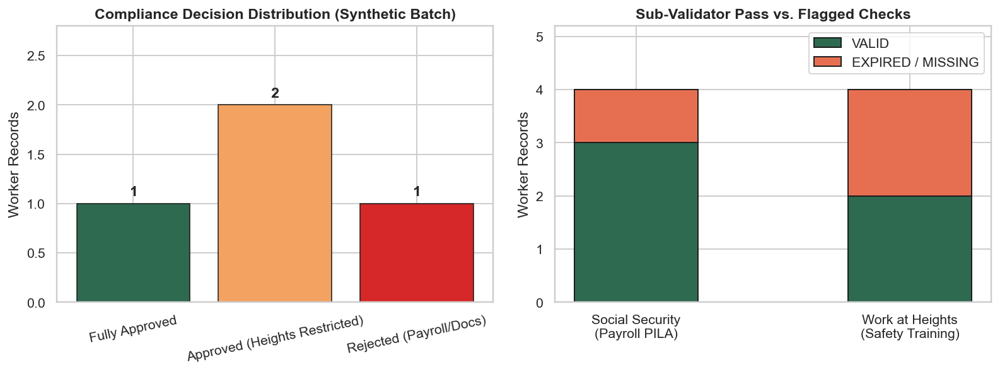

<div align="center">

# Motor de Validación Documental Multimodal con Document AI y Gemini

**Procesamiento Inteligente de Documentos Orientado a Eventos (`Document AI` · `Cloud Vision` · `Gemini` · `Pydantic`)**

[](https://www.python.org/)
[](https://ai.google.dev/)
[](https://cloud.google.com/document-ai)
[](https://docs.pydantic.dev/)
[](#pruebas-y-controles-redundantes-de-seguridad)
[](LICENSE)

**Idioma / Language:** [English](README.md) | **Español (Versión Completa)**

</div>

---

## Resumen Ejecutivo

Los procesos de control de acceso y cumplimiento laboral para contratistas requieren auditar decenas de PDFs por solicitud —planillas consolidadas mensuales de seguridad social (tablas multipágina) mezcladas con certificados individuales de capacitación en trabajo seguro en alturas— antes de autorizar ingresos a instalaciones. La revisión manual genera cuellos de botella, omite vencimientos o pasa por alto discrepancias entre empleador y aportante.

Este repositorio empaqueta una **arquitectura modular de Document AI Multimodal + Motor Determinista de Cumplimiento**. Separa el razonamiento probabilístico del LLM de la lógica legal determinista, agrupa tickets mediante un *watcher* con ventana *debounce*, clasifica y divide certificados multipágina, tolera errores de OCR con validación difusa segura y genera reportes auditables en Excel y JSON.

> **Aviso de Confidencialidad y Gobernanza:** Todas las credenciales de nube, IDs de carpetas, enlaces a hojas de cálculo, identidades reales, NITs y nombres corporativos/operativos han sido **completamente eliminados**. Los insumos incluidos en `data/fixtures/` son **100% sintéticos** (`ACME Contractor SAS`, `Jane Doe`, `Robert Smith`, `Elena Gomez`, `Marco Silva`), y controles automáticos multicapa escanean código, notebooks, contenido binario de PDFs/Excel e historial Git para garantizar cero fugas.

---

## Arquitectura del Sistema

```mermaid
flowchart LR
    A["Llegada de Archivos por Ticket<br/>(Listado Excel + PDFs)"] --> B["Watcher con Debounce<br/>Cola FIFO + Agrupación por Ticket"]
    B --> C["Clasificador y Divisor PDF<br/>Mantiene Planillas | Separa Certificados"]
    C --> D["Cascada OCR Multibackend<br/>Document AI Tablas -> Cloud Vision -> PDF Local"]
    D --> E["Extractor Estructurado Gemini<br/>Pydantic JSON + Caché SHA-256"]
    E --> F["Validación Difusa y Cruzada<br/>Lookalikes OCR + Corrección Cronológica"]
    F --> G["Motor Determinista de Reglas<br/>Calendario PILA + Vigencia Alturas + Cruce Tax-ID"]
    G --> H["Salidas Auditables<br/>Excel Sanitizado (>26 cols) + JSON Resumen"]
```



---

## Decisiones Clave de Ingeniería

### 1. Separación entre Extracción Probabilística (LLM) y Reglas Deterministas
* **El LLM extrae; el código decide:** Gemini (`gemini-2.5-flash`) produce JSON validado con `Pydantic v2` (`PayrollExtraction`, `SafetyCertExtraction`), mientras los validadores en Python calculan fechas límite y dictámenes finales (`ComplianceEvaluator`).
* **Corrección Cronológica Determinista:** `SafetyTrainingValidator.select_most_recent_course_date` ordena cronológicamente todas las fechas de curso detectadas y corrige al modelo si seleccionó por error una certificación anterior.
* **Protección contra Falsos Positivos *Off-by-1* en Cédulas:** Al tolerar errores OCR (`O->0`, `l->1`, `S->5`, distancia Levenshtein `<= 1`), la validación exige coincidencia exacta de dígitos o respaldo simultáneo por similitud de nombre —evitando aprobar falsamente a un trabajador ausente cuyo ID difiera en 1 dígito de un compañero en la misma planilla.

### 2. Agrupación Event-Driven y División Inteligente de PDFs
* **`DebouncedTicketWatcher`:** Agrupa adjuntos por prefijo de ticket (`REQ-####_...`), reinicia temporizadores hasta recibir el paquete completo y despacha workers FIFO *thread-safe* sin duplicar ejecuciones.
* **`PdfDocumentSplitter` (`pypdf`):** Analiza PDFs multipágina para conservar intactas las planillas consolidadas multi-empleado mientras separa página por página los lotes de certificados individuales.

### 3. Robustez en Producción y Compatibilidad Offline
* **Cascada OCR (`CompositeOcrCascade`):** Utiliza **Google Cloud Document AI** (extracción de tablas y *text anchors*) → **Cloud Vision OCR** con el extra `[gcp]`, y ofrece **`LocalPdfTextBackend` + `RuleBasedMockExtractor`** para correr todo el pipeline E2E de forma 100% offline y gratuita en CI o portafolio.
* **Corrección de Rango Excel (`>26` Columnas):** Reemplaza el cálculo manual `chr(65 + n)` por `openpyxl.utils.get_column_letter` y sanitiza valores `None`/`NaN`/`NaT`/`null` mediante `sanitize_cell_value`.

---

## Resultados Verificados en el Lote Sintético E2E

Al ejecutar el pipeline completo sobre `data/fixtures/REQ-1001_*`, se validan automáticamente 4 escenarios representativos:

| Worker ID | Trabajador Sintético | Estado Seguridad Social | Estado Alturas | Dictamen General | Regla Evaluada |
| :--- | :--- | :---: | :---: | :--- | :--- |
| `901234561` | Jane Doe | `VALID` | `VALID` | `APPROVED` | `NO_ISSUES` (coincidencia de NIT `900123451`, todo vigente) |
| `901234562` | Robert Smith | `VALID` | `VALID` | `APPROVED` | Alturas restringido: discrepancia de empleador (`900123451 != 800999888`, Res. 4272/2021) + corrección a fecha reciente (`2025-11-20`) |
| `901234563` | Elena Gomez | `VALID` | `EXPIRED` | `APPROVED` | Alturas restringido: capacitación >18 meses vencida |
| `901234564` | Marco Silva | `MISSING_DOCUMENTS` | `MISSING_DOCUMENTS` | `REJECTED` | Acceso denegado: sin soporte de seguridad social (protegido contra falso positivo *off-by-1*) |



---

## Estructura del Proyecto

```text
docai-gemini-compliance-engine/
├── .github/workflows/ci.yml        # CI automático: Ruff + Auditoría Seguridad + Pytest
├── .env.example                    # Plantilla limpia de entorno (sin secretos)
├── configs/compliance.yaml         # Mapeo de columnas, umbrales y parámetros
├── data/
│   └── fixtures/                   # Lote Excel y PDFs 100% sintéticos
├── notebooks/
│   └── 01_compliance_pipeline_demo.ipynb  # Demo ejecutado sobre fixtures sintéticos
├── reports/figures/                # Gráfica resumen del lote validado
├── scripts/
│   ├── generate_synthetic_fixtures.py     # Generador reproducible de Excel y PDFs de prueba
│   ├── generate_figures.py                # Gráfica de distribución de dictámenes
│   └── audit_confidentiality.py           # Escáner redundante 3 capas (texto, PDF/XLSX, Git)
├── src/compliance_engine/
│   ├── config.py                   # Cargador YAML y esquema canónico de 26 columnas
│   ├── cli.py                      # Comandos CLI (`compliance-run`, `compliance-fixtures`)
│   ├── watcher/queue_watcher.py    # Watcher thread-safe con debounce y cola FIFO
│   ├── pdf/splitter.py             # Clasificador y separador multipágina con pypdf
│   ├── ocr/                        # Cascada Document AI -> Vision -> Local + fuzzy match
│   ├── llm/extractor.py            # Extractor Pydantic v2 con Gemini + modo offline
│   ├── validators/                 # Calendario PILA, alturas +18m y ComplianceEvaluator
│   └── pipelines/                  # Lectura/escritura Excel (>26 cols) y orquestación E2E
└── tests/
    ├── unit/                       # Pruebas unitarias aisladas (OCR fuzzy, reglas, watcher)
    ├── integration/                # Exportación Excel ancho (>26 cols) y cascada OCR
    ├── e2e/                        # Flujo completo Excel+PDF -> Excel+JSON sintético
    └── test_security_audit.py      # Escaneo anti-fugas + autoprueba negativa del escáner
```

---

## Guía Rápida de Ejecución (Quickstart)

### 1. Instalación (funciona offline sin credenciales de Google Cloud)
```bash
git clone https://github.com/ricardo2591/docai-gemini-compliance-engine.git
cd docai-gemini-compliance-engine
pip install -e ".[dev]"

# Opcional: dependencias para Document AI, Cloud Vision, Gemini y Google Sheets en vivo
pip install -e ".[gcp,dev]"
```

### 2. Ejecutar el pipeline completo sobre los fixtures sintéticos
```bash
# Opcional: regenerar fixtures sintéticos Excel y PDF
python scripts/generate_synthetic_fixtures.py

# Ejecutar flujo completo (clasifica/separa PDFs, valida reglas y exporta Excel + JSON)
python -m compliance_engine.cli run

# Generar gráfica de resumen
python scripts/generate_figures.py
```

### 3. Pruebas y Controles Redundantes de Seguridad
```bash
ruff check src tests scripts
python scripts/audit_confidentiality.py
pytest -v
```

---

## Autor

**Ricardo Burgos** — AI Engineer  
Proyecto de portafolio diseñado para demostrar orquestación multimodal con Document AI, extracción tipada con Gemini y Pydantic, desacoplamiento de reglas deterministas de negocio y controles automatizados de QA y privacidad.
