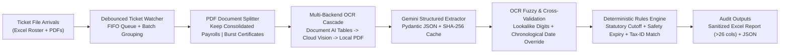
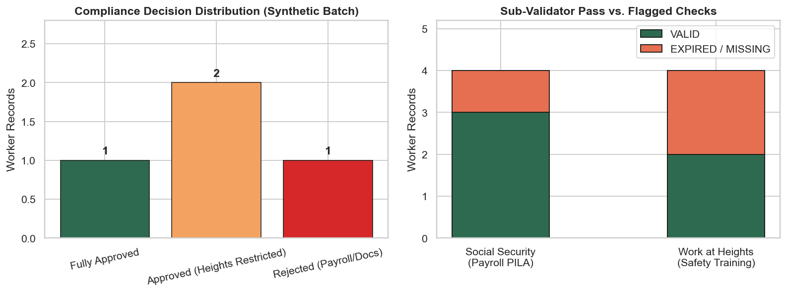

<div align="center">

# Multimodal Document AI & Compliance Validation Engine

**Event-Driven Intelligent Document Processing (`Document AI` · `Cloud Vision` · `Gemini` · `Pydantic`)**

[](https://www.python.org/)
[](https://ai.google.dev/)
[](https://cloud.google.com/document-ai)
[](https://docs.pydantic.dev/)
[](#testing--redundant-security-guardrails)
[](LICENSE)

**Language / Idioma:** **English** | [Español (Versión Completa)](README.es.md)

</div>

---

## Executive Summary

Field operations and site-access workflows require verifying dozens of contractor compliance PDFs per request—consolidated monthly social-security payrolls (multi-page tables) mixed alongside individual occupational safety-at-heights training certificates—before granting facility access. Manual document review creates bottlenecks, misses expired renewals, or confuses employer tax IDs across subcontractors.

This repository packages a **production-grade, modular Multimodal Document AI & Deterministic Compliance Engine**. It decouples probabilistic LLM document understanding from statutory legal/compliance rules, orchestrates ticket batches with debounced workers, separates multi-page individual certificates via OCR+LLM classification, validates IDs with noisy-OCR fuzzy matching, and renders audit-ready Excel workbooks and JSON summaries.

> **Confidentiality & Privacy Governance Notice:** All cloud credentials, drive folder IDs, spreadsheet links, real worker identities, tax IDs, and internal operator labels have been **completely scrubbed**. Included fixtures (`data/fixtures/`) are **100% synthetic** (`ACME Contractor SAS`, `Jane Doe`, `Robert Smith`, `Elena Gomez`, `Marco Silva`), and multi-layer CI checks scan source text, notebook outputs, binary PDF/Excel contents, and Git history for zero PII/secret leaks.

---

## System Architecture



---

## Key Engineering Highlights

### 1. Decoupled Probabilistic AI + Deterministic Compliance Rules
* **LLMs extract; deterministic rules decide:** Gemini (`gemini-2.5-flash`) extracts structured JSON validated via `Pydantic v2` (`PayrollExtraction`, `SafetyCertExtraction`), while pure Python validators compute cutoffs and final authorization flags (`ComplianceEvaluator`).
* **Deterministic Date Override Guardrail:** `SafetyTrainingValidator.select_most_recent_course_date` chronologically parses all extracted course dates and overrides the LLM if it inadvertently selects an older training date.
* **Resilience Against Off-by-1 Sequence False Positives:** During fuzzy OCR verification (`O->0`, `l->1`, `S->5`, Levenshtein distance `<= 1`), ID matching requires exact digit presence or corroborating worker-name overlap before accepting distance-1 fallbacks—eliminating false approvals when an unlisted worker's ID sits 1 digit away from a listed coworker.

### 2. Event-Driven Ticket Batching & Smart PDF Splitting
* **`DebouncedTicketWatcher`:** Groups incoming uploads by ticket prefix (`REQ-####_...`), resets per-ticket timers until attachment bursts finish arriving, and dispatches thread-safe FIFO workers without duplicate processing.
* **`PdfDocumentSplitter` (`pypdf`):** Inspects multi-page PDFs with OCR + structured classification to retain consolidated multi-worker payroll tables whole while bursting bundled individual certificates page-by-page.

### 3. Production Hardening & Schema Safety
* **Multi-Backend OCR Cascade (`CompositeOcrCascade`):** Supports **Google Cloud Document AI** (with layout & table column parsing) → **Google Cloud Vision OCR** fallback in `[gcp]` mode, seamlessly dropping to **`LocalPdfTextBackend` + `RuleBasedMockExtractor`** for zero-credential offline execution and CI verification.
* **Spreadsheet Overflow Fix (`>26` Columns):** Replaces brittle `chr(65 + idx)` Excel column addressing with `openpyxl.utils.get_column_letter` and normalizes `None`/`NaN`/`NaT`/`null` values cleanly via `sanitize_cell_value`.

---

## Synthetic End-to-End Verification Results

Executing the full pipeline on the included synthetic batch (`data/fixtures/REQ-1001_*`) validates four distinct real-world decision paths automatically:

| Worker ID | Synthetic Worker | Payroll Status | Safety Status | Overall Outcome | Triggered Compliance Rule |
| :--- | :--- | :---: | :---: | :--- | :--- |
| `901234561` | Jane Doe | `VALID` | `VALID` | `APPROVED` | `NO_ISSUES` (Tax ID match `900123451`, all valid) |
| `901234562` | Robert Smith | `VALID` | `VALID` | `APPROVED` | Restricted work-at-heights: employer Tax ID mismatch (`900123451 != 800999888`, Res. 4272/2021) + chronological date override (`2025-11-20`) |
| `901234563` | Elena Gomez | `VALID` | `EXPIRED` | `APPROVED` | Restricted work-at-heights: training >18 months old |
| `901234564` | Marco Silva | `MISSING_DOCUMENTS` | `MISSING_DOCUMENTS` | `REJECTED` | Access denied: missing social-security proof (protected against off-by-1 fuzzy false positive) |



---

## Project Structure

```text
docai-gemini-compliance-engine/
├── .github/workflows/ci.yml        # Automated Ruff + Redundant Security Scan + Pytest CI
├── .env.example                    # Cloud runtime config template (no secrets)
├── configs/compliance.yaml         # Configurable template mapping, cutoffs & thresholds
├── data/
│   └── fixtures/                   # 100% synthetic Excel request & PDF bundles
├── notebooks/
│   └── 01_compliance_pipeline_demo.ipynb  # Executed offline pipeline & table inspection demo
├── reports/figures/                # Summary visualizations from synthetic validation runs
├── scripts/
│   ├── generate_synthetic_fixtures.py     # Builds synthetic Excel & multi-page PDF bundles
│   ├── generate_figures.py                # Renders validation outcome breakdown chart
│   └── audit_confidentiality.py           # 3-layer scanner (text, PDF/XLSX binaries, Git log)
├── src/compliance_engine/
│   ├── config.py                   # YAML loader & 26-column canonical output schema
│   ├── cli.py                      # CLI entrypoints (`compliance-run`, `compliance-fixtures`)
│   ├── watcher/queue_watcher.py    # Thread-safe debounced ticket grouping & FIFO queue
│   ├── pdf/splitter.py             # pypdf classifier & multi-page certificate splitter
│   ├── ocr/                        # Document AI -> Vision -> Local PDF cascade & fuzzy matching
│   ├── llm/extractor.py            # Pydantic v2 Gemini extractor + deterministic offline mode
│   ├── validators/                 # PILA deadline matrix, safety +18m & ComplianceEvaluator
│   └── pipelines/                  # Excel IO (>26 cols safe) & batch runner orchestration
└── tests/
    ├── unit/                       # Isolated fuzzy OCR, PILA, safety, evaluator & watcher tests
    ├── integration/                # Wide Excel (>26 cols), null cleanup & OCR cascade tests
    ├── e2e/                        # Full Excel+PDF -> Excel+JSON synthetic E2E validation
    └── test_security_audit.py      # Redundant leak scan + detector negative self-tests
```

---

## Quickstart

### 1. Install package (offline mode works with zero GCP credentials)
```bash
git clone https://github.com/ricardo2591/docai-gemini-compliance-engine.git
cd docai-gemini-compliance-engine
pip install -e ".[dev]"

# Optional: add Google Cloud Document AI, Cloud Vision, Gemini & Sheets dependencies
pip install -e ".[gcp,dev]"
```

### 2. Run the end-to-end compliance pipeline on synthetic fixtures
```bash
# Optional: regenerate synthetic Excel + PDF fixtures from scratch
python scripts/generate_synthetic_fixtures.py

# Run pipeline offline (splits multi-page certs, validates payroll/safety, exports Excel+JSON)
python -m compliance_engine.cli run

# Generate summary figure
python scripts/generate_figures.py
```

### 3. Testing & Redundant Security Guardrails
```bash
ruff check src tests scripts
python scripts/audit_confidentiality.py
pytest -v
```

---

## Author

**Ricardo Burgos** — AI Engineer  
Portfolio project demonstrating resilient Multimodal Document AI orchestration, Pydantic structured LLM extraction, deterministic compliance rule enforcement, and multi-layer QA/security verification.
